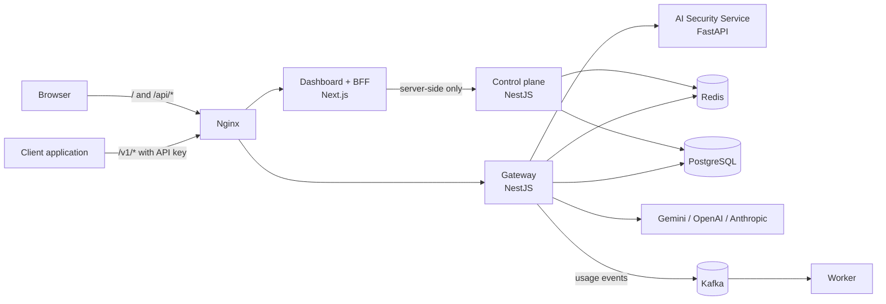

# Tollbooth AI

**A multi-tenant LLM gateway with spend controls, access control and an audit trail.**

Tollbooth AI sits between applications and model providers. Applications call one OpenAI-compatible endpoint
with a revocable API key. The gateway decides who may call what, how often, and how much it may cost, before
a request reaches Gemini, OpenAI or Anthropic, and records every call. A dashboard shows usage, spend,
provider health and an audit log per tenant.

## Live demo

There is no hosted instance tied to this repository yet. The demo runs locally in a few minutes, with
generated sample data and no sign-up: a read-only workspace entered with one click, no password.

```bash
pnpm install && pnpm --filter "./packages/*" build
cp .env.example .env                 # set JWT_SECRET; set DEMO_MODE=true
echo "DEMO_MODE=true" > apps/dashboard/.env.local
pnpm infra:up && pnpm db:migrate && pnpm db:seed:demo
pnpm --filter @tollbooth/control-plane dev &
pnpm --filter @tollbooth/dashboard dev      # http://localhost:3002, then "Explore Live Demo"
```

How the demo stays safe (no shared password, read-only, short sessions) is in
[docs/adr/0007-public-demo-architecture.md](docs/adr/0007-public-demo-architecture.md). Hosting it publicly is
described in [docs/deployment.md](docs/deployment.md).

## Architecture



The edge routes `/v1/*` to the gateway and everything else, including the browser-facing `/api/auth/*` and
`/api/cp/*` routes, to the dashboard. **The control plane is not reachable from the edge**: only the
dashboard's server code talks to it, over a private network. The full design is in
[docs/architecture/system-design.md](docs/architecture/system-design.md).

## What it does

- **OpenAI-compatible gateway** (`POST /v1/chat/completions`) in front of Gemini, OpenAI and Anthropic.
- **Per-tenant traffic control**: requests and tokens per minute, per tenant and per key, counted atomically
  in Redis; a monthly (and optional daily) budget, reserved before the call and settled after it.
- **Provider resilience**: a circuit breaker shared by every gateway instance, bounded retries for transient
  failures, and an explicit policy for when Redis or the security service is down.
- **AI Security Service**: PII, prompt-injection and content checks on every request.
- **Multi-tenancy and RBAC**: six roles over one permission matrix; composite foreign keys make cross-tenant
  references impossible in the database.
- **Authentication**: short-lived JWTs, rotating refresh tokens with replay detection, tokens kept in httpOnly
  cookies by the dashboard's backend-for-frontend.
- **Usage, cost and audit**: every request is recorded with model, tokens, latency and cost; an append-only
  ledger; audit logs; alerts for budgets, provider errors and security findings.
- **Dashboard**: overview (requests, tokens, cost, error rate, p95 latency, provider and circuit health, budget,
  recent requests), analytics, teams, projects, API keys, billing, audit logs, settings.

## Engineering challenges

| Problem                                                                                  | What was done                                                                                                           | Where                                                 |
| ---------------------------------------------------------------------------------------- | ----------------------------------------------------------------------------------------------------------------------- | ----------------------------------------------------- |
| Two gateway instances must never both spend the last token or both become the trial call | Counters, budget reservation and the circuit breaker are Lua scripts executed inside Redis                              | [redis-layer](docs/architecture/redis-layer.md)       |
| What happens when Redis is down                                                          | Fail closed by default (limits cannot be enforced); a switch trades protection for availability                         | [redis-layer](docs/architecture/redis-layer.md)       |
| A rotating refresh token and a page that fires several requests at once                  | The dashboard server coalesces concurrent refreshes into one exchange, so a replay is only ever a real replay           | [dashboard guide](docs/frontend/dashboard-guide.md)   |
| Cross-tenant leaks                                                                       | `tenantId` on every table, composite foreign keys, tenant resolved from the database not the token, e2e isolation tests | [database design](docs/database/database-design.md)   |
| A public demo without a shared password                                                  | A passwordless, read-only, time-limited session in a flagged tenant, enforced by a guard on the server                  | [ADR 0007](docs/adr/0007-public-demo-architecture.md) |
| Deploying from nothing                                                                   | One-shot migration job, idempotent seeds, a container stack tested end to end in CI                                     | [deployment](docs/deployment.md)                      |

## Request lifecycle

1. The API key is hashed and looked up; it names the tenant, project and permissions.
2. Requests and tokens per minute are counted in Redis for the tenant and the key.
3. The worst-case cost is reserved against the budget.
4. The AI Security Service checks the content.
5. The provider router picks a provider for the model; the circuit breaker keeps calls off a failing one.
6. The provider is called with a timeout, retrying transient failures a bounded number of times.
7. Usage, cost and a ledger entry are written, the budget reservation is settled, and a usage event is
   published to Kafka.

## Quick start

Prerequisites: Node.js 22+, pnpm 10+, Docker with Compose v2, Python 3.12+ (for the AI service).

```bash
pnpm install
pnpm --filter "./packages/*" build
cp .env.example .env                 # set JWT_SECRET (openssl rand -base64 48)
pnpm infra:up                        # Postgres, Redis, Kafka, Prometheus, Grafana
pnpm db:migrate && pnpm db:seed      # schema, reference data, and a development tenant

pnpm --filter @tollbooth/gateway dev          # :3000
pnpm --filter @tollbooth/control-plane dev    # :3001
pnpm --filter @tollbooth/dashboard dev        # :3002, sign in as admin@techcorp.com / ChangeMe123!
```

The development seed creates users with a **publicly documented password** and refuses to run when
`NODE_ENV=production`. Set `GOOGLE_AI_API_KEY` to send real requests; `pnpm gateway:test` sends one.
Each service listens on its own port variable (`GATEWAY_PORT`, `CONTROL_PLANE_PORT`, `WORKER_PORT`), then on
`PORT`, then on its default, so one `.env` can serve all of them.

### The production-style stack

```bash
cp .env.production.example .env.production      # fill in the secrets
docker compose --env-file .env.production -f docker-compose.prod.yml up -d --build
```

This starts everything behind Nginx on port 80, runs migrations first as a one-shot job, and keeps the
control plane private. See [docs/deployment.md](docs/deployment.md).

## API example

```bash
curl http://localhost:3000/v1/chat/completions \
  -H "Authorization: Bearer $TOLLBOOTH_API_KEY" \
  -H "Content-Type: application/json" \
  -d '{"model":"gemini-2.0-flash","messages":[{"role":"user","content":"Say hello."}]}'
```

The response is the OpenAI chat-completion shape, plus `usage.estimated_cost` (USD). Errors use the OpenAI
error format. Details: [docs/api/gateway-api.md](docs/api/gateway-api.md).

## Testing

```bash
pnpm lint && pnpm format:check && pnpm typecheck && pnpm test      # static checks and unit tests
pnpm --filter @tollbooth/control-plane test:e2e                      # real Postgres, Redis for traffic tests
pnpm --filter @tollbooth/gateway test:e2e                            # local fakes of the three providers
cd apps/ai-service && pip install -e ".[dev]" && ruff check . && pytest
bash scripts/smoke/nginx-routing.sh      # edge routing, against stub upstreams (needs Docker)
bash scripts/smoke/compose-stack.sh      # the whole production stack, from empty volumes (needs Docker)
```

The end-to-end suites refuse to run against a non-local database or Redis unless `E2E_ALLOW_REMOTE=true`.
CI runs all of the above, plus a migration/schema drift check, seed idempotency, and a build of every image.

## Deployment

`docker-compose.prod.yml` runs the full stack on one Docker host. A lower-cost public profile (dashboard,
control plane, gateway and AI service on a hosted platform, with managed Postgres and Redis) is described in
[docs/deployment.md](docs/deployment.md), including what changes without Kafka and the worker.

## Design decisions

- [ADR 0007: public demo architecture](docs/adr/0007-public-demo-architecture.md)
- [Security model: proxies, cookies, rate limits](docs/security.md)
- [Redis layer](docs/architecture/redis-layer.md), [provider router](docs/architecture/provider-router.md),
  [cost engine](docs/architecture/usage-cost-engine.md), [events](docs/architecture/kafka-events.md),
  [AI security](docs/architecture/ai-security.md)

## Measured performance

No benchmark figures are published. `k6/load-test.js` is a load script, but numbers from it are worth showing
only with the machine and settings they came from, and none have been recorded for that yet.

## Repository layout

```
apps/gateway        OpenAI-compatible gateway (NestJS)
apps/control-plane  management API: auth, tenants, users, teams, projects, keys, analytics (NestJS)
apps/dashboard      Next.js dashboard, landing page and backend-for-frontend routes
apps/worker         Kafka consumer (NestJS)
apps/ai-service     PII / prompt-injection / content checks (FastAPI)
packages/config     per-service environment validation
packages/database   Prisma client and Nest module
packages/kafka      Kafka producer/consumer wrapper and event types
packages/shared     permission matrix and cross-service contracts
prisma/             schema, migrations, seeds (reference, dev, demo)
infra/              Dockerfiles, Nginx, Redis, Prometheus, Grafana
scripts/smoke/      container-level smoke tests
docs/               architecture, API, security, deployment, ADRs
```

## Limitations and trade-offs

This list is the honest counterpart of the feature list above.

- **No streaming.** `stream: true` is rejected with a 400.
- **Retries, not failover.** Transient provider failures are retried against the same provider; a request is
  not moved to another provider.
- **Limits are not yet policy-driven.** The gateway enforces a key's own rate limit (falling back to its
  team's requests-per-minute), the allowed-models lists of a key's team and project, and per-plan limits that
  are fixed in `apps/gateway/src/traffic/plan-limits.ts`. Team daily and token limits and budgets, project
  budgets, billing-plan rows and the Settings page values are stored and shown but **not read by the
  gateway**; the dashboard says so where it matters. The budget on the dashboard comes from billing records and
  can differ from the fixed per-plan figure the gateway enforces.
- **Events can be lost.** The gateway writes to PostgreSQL and then publishes to Kafka; there is no outbox, so
  an event is dropped if Kafka is unavailable at that moment. The worker currently only logs what it consumes.
- **Exact-match cache.** The AI service's cache keys on a hash of the prompt and is not called from the
  gateway's request path. The `vector` extension is enabled in PostgreSQL but nothing uses it yet.
- **Observability.** Structured logs and Prometheus metrics for the gateway; no distributed tracing, and the
  control plane exposes no metrics.
- **API shape.** No generated OpenAPI document. Some list endpoints (projects, API keys, teams) are not
  paginated and compute per-row aggregates with one query each.
- **Image size.** Measured on Alpine: gateway about 740 MB and control plane about 690 MB (the Prisma client
  and its dependencies are a large part), dashboard about 330 MB, worker about 320 MB, AI service about 240 MB.
- **Single Kafka broker, single Redis**, as is typical for a demo; neither is configured for high availability.
